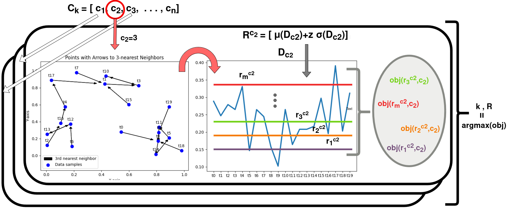

# Explainable Parameter-free Streaming Distance-based Outlier Detection

Code of the BSc thesis *Explainability in Parameter-free Streaming Distance-based Outlier Detection*
(Konstantinos Takis, Aristotle University of Thessaloniki, 2026; supervisor: Anastasios Gounaris).

## Previous work (ADBOD)

This code extends [ADBOD](https://github.com/agiannoul/ADBOD) [1]. ADBOD proposed **Dyn**, a parameter-free version of
distance-based outlier detection (DOD) for data streams. In every sliding window, Dyn selects the number of neighbours `k`
and the radius `R` that maximise an objective function. It then marks as outliers the points that have fewer than `k`
neighbours within `R`. The output is binary (outlier / inlier), with no explanation.



The original ADBOD files are kept here: `main.py`, `ExperimentTSB.py`, `RunExperiments.py`, `Techniques/dynamic.py` (Dyn),
`Techniques/distanceKR.py` (static DOD), `TSB_UAD_code/` (sub-sequence windowing) and `data/YAHOO/`.

## What this work adds

For every outlier that Dyn detects, we also explain **why** it is an outlier. We assign one of six semantic classes, following
Toliopoulos & Gounaris [2]: *Isolated*, *Near cluster*, *Sparse microcluster*, *Sparse cluster*, *Dense microcluster* and
*Dense cluster*.

- We count the neighbours of the outlier at five radii (`R/4, R/2, R, 2R, 4R`), using the `k` and `R` that Dyn has
  already selected for the window.
- We label the outlier in three ways: NN-based, status-based (a 5x5 matrix over radii and `k` thresholds), and a
  combination of the two that keeps the strictest label.
- Detection does not change. The explainable Dyn makes exactly the same outlier decisions as Dyn.

There are two implementations:

| File | Class | Description |
|---|---|---|
| `Techniques/dynamic_expl.py` | `dynamic_kr_expl` | **Final version.** Reuses the distance matrix of Dyn, so the explanations need no extra distance computations. |
| `Techniques/dynamic_expl3.py` | `dynamic_kr` | Naive version, kept for comparison. Recomputes the distance matrix for the explanations. |

After `fit()`, the model also exposes `outlier_labels` (one label per point, `"Inlier"` for normal points),
`k_history` / `r_history` (selected `k`, `R` per window, `-1` when no valid pair was found), and `label_telemetry` /
`density_profiles` (details of every labelled outlier).

## Installation

Python 3 with pip is enough (tested with Python 3.11):

```
pip install -r requirements.txt
```

`environment.yaml` is ADBOD's original conda environment (Python 3.8). It is optional and does not include `seaborn`.

## How to run

Run all commands from this folder, because the scripts use relative paths.

**1. Quick example.** Detect and explain the outliers of one Yahoo stream:

```
python main_expl.py
```

This prints every detected outlier with its label (e.g. `Timestamp Index 1448: Outlier Detected -> Explanation: Dense cluster`)
and plots the static DOD and Dyn detections against the ground truth.

**2. Use it in your own code.**

```python
from TSB_UAD_code.feature import Window
from Techniques.dynamic_expl import dynamic_kr_expl

X = Window(window=10).convert(values).to_numpy()   # values: 1-D array of the stream
model = dynamic_kr_expl(window=200, slide=100)
scores = model.fit(X)                               # 1 = outlier, 0 = inlier (one per sub-sequence)
labels = model.outlier_labels                       # semantic label of each sub-sequence
```

**3. Experiments on the Yahoo benchmark.** Runs the explainable Dyn on Yahoo A1-A4. It reports the AD1 F1 and the
running time, and writes the label distribution of every stream to `results/results_explain.csv`:

```
python RunExperiment_expl.py
```

**4. Thesis figures.** Reproduces all figures of the thesis and prints every number quoted in Chapter 5 (about 2.5 minutes):

```
python generate_chapter5_evaluation_graphs.py    # Figures 5.1-5.12
python generate_chapter2_illustration.py         # Figure 2.1
```

The figures are written to `data/graphs/`. The per-stream AD1 F1 of static DOD, Dyn and explainable Dyn on all 416 labelled
Yahoo and NAB streams is written to `data/graphs/Evaluation_Results/full_367_yahoo_nab_evaluation.csv`.

**Comparing with the naive version.** `main_expl.py` and `experiment_expl.py` (used by `RunExperiment_expl.py`) import the
final version. To run the naive one instead, switch the import at the top of the file (the line is already there, commented out):

```python
from Techniques.dynamic_expl import dynamic_kr_expl as Dyn   # final (default)
# from Techniques.dynamic_expl3 import dynamic_kr as Dyn      # naive, for comparison
```

## Folder structure

| Path | Content |
|---|---|
| `Techniques/` | Dyn (`dynamic.py`), static DOD (`distanceKR.py`), explainable Dyn (`dynamic_expl.py`, `dynamic_expl3.py`) |
| `main_expl.py`, `experiment_expl.py`, `RunExperiment_expl.py` | Explainable counterparts of ADBOD's `main.py`, `ExperimentTSB.py`, `RunExperiments.py` |
| `generate_chapter5_evaluation_graphs.py`, `generate_chapter2_illustration.py` | Thesis figures |
| `TSB_UAD_code/` | Sub-sequence windowing (from TSB-UAD) |
| `data/YAHOO/` | Yahoo S5 streams (`value,label`) |
| `data/NAB_formatted/` | NAB streams in the same format, created from `data/NAB_Archive/` by `data/format_nab.py` |
| `data/NAB_Archive/` | Original NAB benchmark; provides the official anomaly windows (`labels/combined_windows.json`) and timestamps |
| `data/graphs/` | Generated figures and evaluation results |

To run ADBOD's original `RunExperiments.py`, first create an empty `results/` folder.

## References

[1] A. Giannoulidis, N. Nikolaidis, A. Gounaris, "Parameter-free Streaming Distance-based Outlier Detection,"
ICDE Workshops (ICDEW), 2024, pp. 102-106, doi:10.1109/ICDEW61823.2024.00019.

[2] T. Toliopoulos, A. Gounaris, "Explainable Distance-Based Outlier Detection in Data Streams," IEEE Access, 2022.
